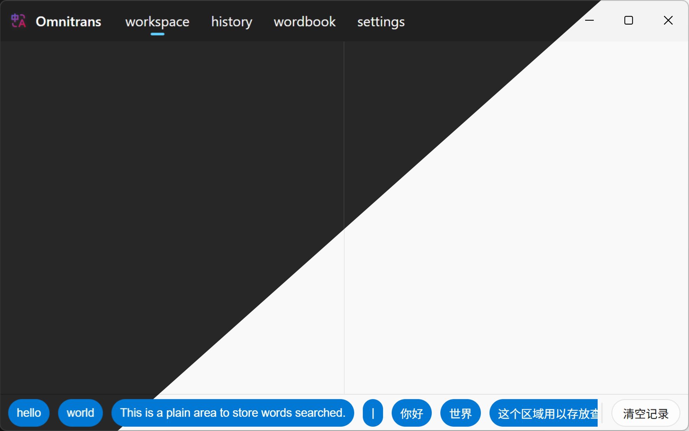

# omnitrans

One electron app which supports searching words anytime and anywhere.

## Features
- Search for translations using multiple sources
- Global hotkey to bring up the search window
- History of searched words
- Favorites for frequently searched words

## Installation
You can download the latest release from the [releases page](https://github.com/MugeTong/omnitrans/releases).

## Usage
1. Launch the application.
2. When you enconter sentences or words you want to translate, select and,
2. Use the global hotkey (default: `Double Ctrl + C`) to open the search window.

## Contributing
Contributions are welcome! Please fork the repository and create a pull request with your changes.

## Acknowledgements
- [DeepL (UI Reference)](https://www.deepl.com/)
- [WinUI3 (UI Reference)](https://learn.microsoft.com/en-us/windows/apps/winui/winui3/)
- [Youdao (Current Translator)](http://www.youdao.com/)
